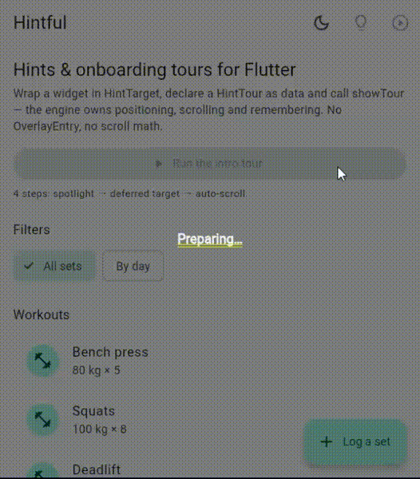
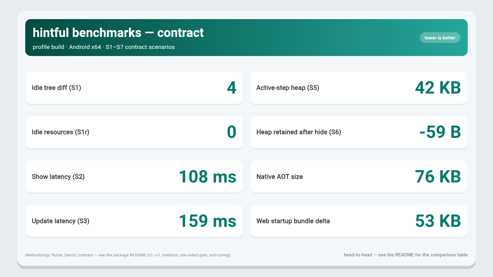

# hintful

[](https://pub.dev/packages/hintful)
[](https://pub.dev/packages/hintful/score)
[](https://github.com/Fellmonkey/hintful/blob/main/LICENSE)
[](https://github.com/Fellmonkey/hintful/actions/workflows/ci.yml)

**Onboarding tours, coach marks and tooltips for Flutter.** Declare tours as
data, wrap targets in `HintTarget(id: ...)` — the engine renders, follows the
targets through scrolling, waits for late ones, remembers what was shown and
tells you why something didn't show.

A code-first library: no SaaS, no no-code builder, no analytics — a
dependency-free engine (Flutter SDK only) you own in your repo.

## See it in action



_Recorded on the `example/` app. Try it live:
[fellmonkey.github.io/hintful](https://fellmonkey.github.io/hintful/)._

## Why hintful

- **Tours follow your UI.** The spotlight, dim and tooltip track the target
  through scroll, layout and animation in the same frame — no drift, no
  one-frame lag.
- **Late targets don't break tours.** A target that isn't built yet (lazy
  list, deferred tab) puts the step into a waiting state with a timeout and a
  policy; a target that vanishes mid-step and comes back resumes the tour.
- **Show once per app version, built in.** Versioned `HintStore`, an atomic
  `tryShowTour` guard, and an optional "want a tour?" pre-dialog whose
  declines persist.
- **Diagnosis over mystery.** Every non-show is a machine-readable event
  (timeout / unknown target / skipped); a typo'd `targetId` gets closest-id
  suggestions in debug.
- **Tours are data.** `HintTour`/`HintStep` are immutable specs with a JSON
  wire format — server- or CDN-driven tours need no extra dependency.
- **Your design system.** Theming through `ThemeExtension`; the default
  palette is WCAG AA contrast-tested in CI.
- **Accessible by default.** Keyboard navigation, focus capture and
  restoration, screen-reader step announcements, text-scale fitting.
- **Cheap and testable.** Zero runtime dependencies, zero engine cost while
  idle, and a headless testing seam (`HintController.test()`).

How hintful compares to tutorial_coach_mark, showcaseview and the wider
landscape — including what those libraries do well and hintful's own
trade-offs — is written down in
[`doc/competitive_analysis.md`](doc/competitive_analysis.md).

## What you write

```dart
// 1. Wrap every widget the tour points at
HintTarget(
  id: 'exerciseSelector',
  child: ExerciseSelector(),
)
// ...or the one-liner sugar: ExerciseSelector().withHint('exerciseSelector')

// 2. Declare the tour — data, not widgets
final introTour = HintTour(
  id: 'intro',
  steps: [
    HintStep(
      targetId: 'exerciseSelector',
      content: HintStepContent(
        title: 'Pick a movement',
        description: 'Filter by muscle, equipment or name.',
      ),
    ),
    HintStep(
      targetId: 'addSet',
      content: HintStepContent(
        title: 'Log your set',
        description: 'Weight × reps, one tap.',
      ),
    ),
  ],
);

// 3. Wire once, show once
final controller = HintController();
controller.showTour(introTour);
```

No `GlobalKey`, no `OverlayEntry`, no `ScrollController`, no manual position.

**Just one tip? No tour needed:**

```dart
controller.showHint(
  HintStep(
    targetId: 'addSet',
    content: HintStepContent(title: 'Swipe left to delete a set'),
  ),
);
```

**Production wiring** — a store once, then guards:

```dart
Hintful.configure(store: CallbackHintStore(read: ..., write: ...));

await controller.tryShowTour(introTour); // atomic: store-checked, `false` when busy

// show once per app version — a version bump re-shows it
await controller.tryShowTour(
  HintTour(id: 'intro', minShowVersion: appVersion, steps: introTour.steps),
  mark: HintMarkPolicy.onAnyExit,
);

// or ask first — the decline is remembered too
await showHintTourOffer(context: context, controller: controller, tour: introTour);
```

No store configured? A session `InMemoryHintStore` keeps show-once working for
this run only (with a one-time warning). A ready-made shared_preferences store
ships in [`hintful_prefs`](https://github.com/Fellmonkey/hintful_prefs).

Just one tip, no tour? `controller.showHint(step)`. Localizing? Swap strings
for `titleBuilder`/`descriptionBuilder` in `HintStepContent`.

## Features

**Tour control** — `showTour/next/previous/goTo/skip/finish`, atomic
`tryShowTour` + `isIdle`; wait-for-target with timeout policy and diagnosis;
scoped controllers (`scopePrefix`) for tabs/split-view; `disableBackButton`;
per-step `onStepEnter`/`onStepExit` hooks.

**Rendering** — live target tracking over a global scrim; auto-flip
positioning with safe-area clamp and a tail to the target; multi-target steps
and multi-content tooltips with overlap avoidance; focus shapes
(rect/circle/rounded) with padding, including negative "shrink spotlight";
optional blur scrim and pulse; auto-scroll to offscreen targets; tap regions
(target vs overlay, per-step behavior) with the page still scrollable under
the tour; full tooltip control via `tooltipBuilder`.

**Content & reuse** — versioned hints (`minShowVersion` + `HintStore` +
`HintMarkPolicy`); "want a tour?" pre-dialog with per-page or global decline
memory; `withHint` sugar and target-level `focusShape`/`focusPadding`;
overridable copy labels.

**Engine** — pure state-machine core with a framework-agnostic state API
(`ValueListenable<HintState>`); headless testing (`HintController.test()`,
`Hintful.reset()`); diagnostics handler; zero runtime dependencies.

## Accessibility

- **Screen readers**: the default tooltip announces `Step N of M: <title>`;
  `HintTarget(semanticsLabel:)` labels the spotlighted widget itself
- **Keyboard**: Tab/Shift+Tab move forward/back, Enter = next, Esc = skip;
  focus is captured while active and restored on exit
- **Text scale**: the tooltip scrolls its content at 2× scale instead of
  overflowing
- **Contrast**: the default theme meets WCAG AA (4.5:1) in light and dark,
  asserted in tests
- **Reduce motion**: the default tooltip has no animation of its own; custom
  `tooltipBuilder` entries should check `MediaQuery.disableAnimations`

## Server-driven tours

`HintTour.fromJson`/`toJson` with your own HTTP client — no extra dependency:

```dart
final body = await http.get(
  Uri.parse('https://cdn.example.com/tours/onboarding'),
); // your client — http, dio, HttpClient, …

final tour = HintTour.fromJson(jsonDecode(body.body) as Map<String, dynamic>);
await controller.showTour(tour);
```

Keep a bundled fallback tour for the offline case. The wire format carries
copy, order, timing and layout of **known** targets — a server cannot
introduce a target that isn't in the shipped build. Details:
[best practices §18](doc/best_practices.md#18-server-driven-tours--what-json-can-and-cannot-carry).

## Getting started

```yaml
dependencies:
  hintful: ^1.0.0
```

```dart
import 'package:hintful/hintful.dart';
```

Requires Dart ≥ 3.2 / Flutter ≥ 3.16. See `example/` for working demos:
shaped holes, blur/pulse styles, custom animated tooltips, JSON tours, tap
regions, multi-target and multi-content steps, the offer dialog, lifecycle
hooks and the versioned intro.

The only supported import is `package:hintful/hintful.dart`; deep imports
(`package:hintful/src/...`) are not part of the API.

## Documentation

- [`doc/best_practices.md`](doc/best_practices.md#index) — one decision per
  section, with the code to copy
- [`doc/faq.md`](doc/faq.md) — "my hint didn't show", `tryShowTour`, text
  scale, RTL, id typos, testing
- [`doc/migration_guide.md`](doc/migration_guide.md) — coming from
  `showcaseview` or `tutorial_coach_mark`, API-to-API
- [`doc/competitive_analysis.md`](doc/competitive_analysis.md) — how hintful
  compares to other tour/hint/onboarding solutions
- [`CHANGELOG.md`](CHANGELOG.md)
- [`benchmark/README.md`](benchmark/README.md) — how the performance numbers
  are recorded

## Verifying

The same commands CI runs:

```bash
# package root
flutter pub get && flutter analyze && flutter test
dart format --set-exit-if-changed .
flutter pub publish --dry-run

# example/
flutter pub get && flutter analyze && flutter test

# benchmark/
flutter pub get && flutter analyze && flutter test bench/
```

MIT licensed.

<!-- bench:start -->
## Performance

One scene, three solutions: the contract scenarios S1–S6 on a profile Android emulator plus the host size builds (S7). Values are the recorded goldens in `benchmarks.json` (refs `android` / `android-scv` / `android-tcm`). Methodology: `benchmark/README.md`; `benchmark/compare` hosts the rival drivers.

| Metric | hintful | showcaseview | tutorial_coach_mark |
|---|---|---|---|
| Idle tree diff (S1) | 4 | 2 | 3 |
| Idle resources (S1r) | 0 | 0 | 0 |
| Show latency (S2) | 108 ms | 163 ms | 774 ms |
| Update latency (S3) | 159 ms | 304 ms | 1418 ms |
| Active-step heap (S5) | 42 KB | 65 KB | 94 KB |
| Heap retained after hide (S6) | -59 B | -325 B | -91 B |
| Native AOT size | 76 KB | n/a | n/a |
| Web startup bundle delta | 53 KB | n/a | n/a |

**n/a** = not applicable for this solution. Scroll coupling (S4) is a two-sided in-scenario assert, not a numeric row: hintful re-anchors its content to the target under programmatic scroll on-device, while showcaseview and tutorial_coach_mark do not (their overlays consume pointer input). The idle-resources row (S1r) is declared on-device via `idleClasses` — 0 means the solution holds no live control-plane instances while idle. The size rows are hintful-only because the rival scenes were never shipped as size targets.

**Trend history:** [charts](https://fellmonkey.github.io/hintful/bench/)



_Recorded 2026-09-12 20:43 UTC. Regenerate: dispatch the `bench-record` workflow with `record`._
<!-- bench:end -->

